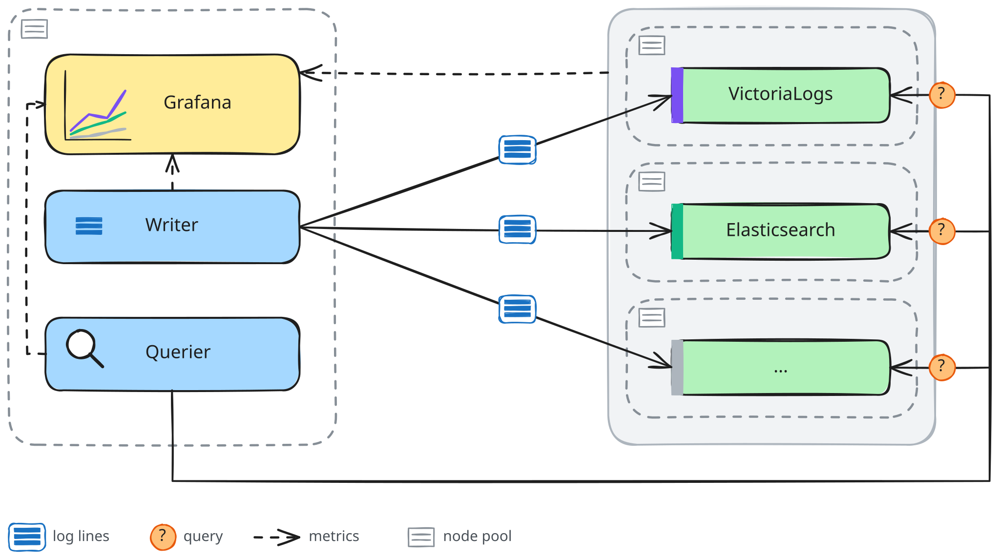

# logs-benchmark

logs-benchmark is a harness that compares engines that store and search
logs. It serves two goals:

- **Guidance for users**: each engine is good at certain use cases, and
  users often ask which one they should use. This benchmark helps them
  answer that question for the kind of logs they have. So far, it covers
  structured logs, as many services on Kubernetes write them. Other kinds,
  such as unstructured logs and wide events, will follow.
- **Internal performance work on VictoriaLogs**: this benchmark shows us
  where VictoriaLogs stands today and which areas to improve next.

Supported engines: VictoriaLogs, Elasticsearch, OpenSearch, Grafana Loki,
SigNoz and ClickStack.

## Roadmap

| # | Benchmark                                              | Deployment          | Status      |
| - | ------------------------------------------------------ | ------------------- | ----------- |
| 1 | Ingestion test, six engines                            | one node per engine | done        |
| 2 | Query test, six engines                                | one node per engine | in progress |
| 3 | Ingestion test, six engines                            | cluster mode        | planned     |
| 4 | Query test, six engines                                | cluster mode        | planned     |
| 5 | Ingestion and query tests, engines with object storage | object storage      | planned     |
| 6 | Ingestion and query tests, other kinds of logs         | to be decided       | planned     |

Each benchmark will get a post on the VictoriaMetrics blog. For benchmark 1,
see the [blog post](https://victoriametrics.com/blog/structured-log-ingestion-benchmark/)
and the [results](results/2026-10-ingest/README.md). For now, the code covers
only the first two benchmarks.

## The workload

Log workloads vary, from unstructured text messages to wide events with
hundreds of fields. The current harness targets the most common shape of
Kubernetes logs: a short text message and a few dozen structured fields.
This is what you get when an application writes JSON logs and a log
collector adds namespace and node metadata.

The first benchmark models a typical cluster of 125 Kubernetes nodes
(hosts), with 40 apps on each host, which gives 5000 log streams. Each log
line has 30 to 40 fields and is about 930 bytes of JSON on average. The
generator uses a fixed seed, so every run produces the same lines.

The generator makes the logs as realistic as it can. Its code is in
[internal/source/synthetic/](internal/source/synthetic/).

## How it works

An **instance** is one deployment of an engine under test, with a node pool
of its own. In the first benchmark, each engine runs as one instance on a
single node, while the cluster-mode benchmarks spread one instance over
several nodes. All these node pools use identical machines. A separate node
pool runs the **harness**, which is not measured:

- The **writer** generates log lines and sends every line to every instance
  in the ingest format of its engine, using the encoder in
  `internal/systems/<engine>.go`.
- The **querier** runs the test queries and asks each instance every 15
  seconds how many rows it has stored.
- **Monitoring** (VictoriaMetrics and Grafana) collects these numbers and
  the resource use of every node.

Everything runs on Kubernetes, and each instance stores its data on disks
attached to its nodes. Object storage comes in a later benchmark (see the
[roadmap](#roadmap)).

### Ingestion test

This test finds the **ceiling** of each instance: the highest rate that it
can store and keep storing.

The writer raises the target rate in steps. In the first
benchmark, it starts at 10k lines/s and adds 10k every 10 minutes, up to
180k. When an instance cannot keep up, the writer drops the extra lines for
that instance only, so the other instances still get the full rate. As a
result, each instance levels off at its own ceiling. The ceiling is the
highest stored rate, averaged over one 10-minute step, among the steps that
the instance finished before its first crash.

The ceiling counts the rows that each instance reports as stored, not the
requests that it accepted, because some engines accept a request before the
data is on disk. SigNoz and ClickStack accept it at their collector, before
it reaches storage.

No test queries run during the ingestion test, so that each engine can use
all of its CPU for ingestion. The querier only asks each instance every 15
seconds how many rows it has stored.

The important metrics are:

- the ceiling, in stored lines per second;
- the CPU and memory (without the page cache) on the way to the ceiling;
- the disk space per million lines;
- the bytes written to disk per stored line, since cloud disks cap write
  throughput.

### Query test

**In progress.** The query numbers are not published yet, and they cannot
be compared across engines.

The writer sends a fixed rate that every instance can handle, and it waits
instead of dropping lines, so all instances hold exactly the same data. The
querier asks each instance six common questions, the kind that users and
dashboards of observability tools often ask:

- the newest error lines
- errors per app
- errors of one app
- a word that matches no line
- a common word
- lines per minute

Each engine answers them in its own query language, with the same meaning,
time window and limit.

The important metrics are:

- the p99 latency of each question, from sending the request to
  reading the last byte of the answer, without retries;
- the rate of failed queries, because a query that fails or times out has
  no latency sample.

## Fairness

Every instance gets the same:

- **input**: one writer, one seed and one target rate;
- **hardware**: identical machines and disks, one node pool each;
- **resources**: no CPU or memory limits, so each instance can use its whole
  machine;
- **setup**: the official chart or operator of each engine, at its
  defaults. A comment in `deploy/systems/<engine>.yml` explains every change
  from the defaults.

The engines still differ in known ways that affect the results:

1. **Durability.** Elasticsearch and OpenSearch write each request to disk,
   with fsync, before they answer it, while the other engines answer
   earlier. With fsync turned off (`index.translog.durability: async`),
   Elasticsearch reached about the same rate, because CPU, not the disk,
   limits its ceiling.
2. **Loki's count.** Loki has no cheap exact count of stored rows, so its
   number is the lines that it accepted. This still counts stored lines,
   because Loki accepts a line only after writing it to its write-ahead log.
3. **Wire format.** Each engine receives its own ingest format. VictoriaLogs
   gets JSON lines, Elasticsearch and OpenSearch get bulk JSON, Loki gets
   protobuf, and SigNoz and ClickStack get OTLP protobuf. Only Loki receives
   a compressed body, because its protobuf push API requires snappy. This is
   somewhat unfair, because logs usually start as JSON, and something must
   convert them to the preferred format of each engine. For example, Loki
   reached about 99k lines/s with JSON and 139k with protobuf in our first
   benchmark. Counting this conversion would make the setup much more complex,
   so the benchmark does not count it yet.
4. **Stack size.** SigNoz and ClickStack each run a whole stack (a
   collector, ClickHouse and other services) that shares one node, while the
   other engines run a single server there.
5. **Indexing.** OpenSearch has no built-in logs template, so it indexes
   most string fields twice (as text and as keyword), while Elasticsearch
   indexes them as keyword only.

## Reproducing a benchmark

Each benchmark has a runbook with its machines, commands and cleanup. The
runbook of the first benchmark is
[deploy/benchmarks/all-systems/README.md](deploy/benchmarks/all-systems/README.md).
This benchmark needs a Kubernetes cluster with seven node pools, six
identical ones for the instances and a larger one for the harness. One run
takes about 4 hours: 3 hours of load, and up to one more hour for the disks
to settle before disk space can be read.
