# Ingestion test, six engines, one node each (October 2026)

Results of benchmark 1 in the [roadmap](../../README.md#roadmap), discussed in
the [blog post](https://victoriametrics.com/blog/structured-log-ingestion-benchmark/).
The method is in the [README](../../README.md) and the
[runbook](../../deploy/benchmarks/all-systems/README.md).

## Setup

Each engine runs on its own n2d-standard-8 node (8 vCPUs, 32 GB of RAM, 500
GiB pd-balanced disk) on GKE v1.36.4.

| Engine        | Version  | Helm chart                   |
| ------------- | -------- | ---------------------------- |
| VictoriaLogs  | v1.53.0  | victoria-logs-single 0.13.10 |
| Loki          | 3.7.8    | loki 18.15.1                 |
| Elasticsearch | 9.5.5    | eck-operator 3.5.0           |
| OpenSearch    | 3.9.0    | opensearch 3.9.0             |
| SigNoz        | v0.145.0 | signoz 0.145.0               |
| ClickStack    | 2.39.1   | clickstack 3.4.0             |

## How the numbers are computed

- Each number is the median of three runs.
- **Maximum ingestion rate**: the highest average stored rate over one
  10-minute step, among the steps before the engine's first crash.
- **CPU** is the step average, **memory** the step peak without the page
  cache, and **disk writes per line** the step average divided by the
  stored rate.
- **N/A**: in at least one run, the engine stored less than 90% of the
  step's target.
- **Disk space** is read after the ramp, once every disk has stayed the same
  for 10 minutes. The compression ratio is the raw JSON size (887 MiB per
  million lines) divided by it.
- Each engine owns its node, so CPU, memory and disk count every pod on it.
  For SigNoz and ClickStack, this includes the collector, ClickHouse, the UI
  and the helper services.

## Results

### Maximum ingestion rate (lines/s)

| Engine        | Median                             | Range over 3 runs |
| ------------- | ---------------------------------- | ----------------- |
| Loki          | 139k                               | 124k to 143k      |
| VictoriaLogs  | 120k                               | 119k to 124k      |
| Elasticsearch | 48k                                | 48k to 49k        |
| OpenSearch    | 28k                                | 27k to 29k        |
| SigNoz        | 10k (crashes at 20k)               | 9k to 10k         |
| ClickStack    | 46k                                | 45k to 50k        |

### CPU (cores)

| Engine        | 10k | 20k | 40k | 80k | 120k | 150k |
| ------------- | --- | --- | --- | --- | ---- | ---- |
| Loki          | 0.4 | 0.7 | 1.6 | 3.7 | 6.1  | N/A  |
| VictoriaLogs  | 0.4 | 0.8 | 1.6 | 4.2 | 7.2  | N/A  |
| Elasticsearch | 1.0 | 2.1 | 5.2 | N/A | N/A  | N/A  |
| OpenSearch    | 1.5 | 4.1 | N/A | N/A | N/A  | N/A  |
| SigNoz        | 4.2 | N/A | N/A | N/A | N/A  | N/A  |
| ClickStack    | 0.9 | 1.8 | 4.0 | N/A | N/A  | N/A  |

### Memory without the page cache (GiB)

Elasticsearch and OpenSearch keep a fixed heap.

| Engine        | 10k  | 20k  | 40k  | 80k  | 120k | 150k |
| ------------- | ---- | ---- | ---- | ---- | ---- | ---- |
| Loki          | 2.8  | 5.6  | 11.4 | 11.4 | 12.8 | N/A  |
| VictoriaLogs  | 0.4  | 0.7  | 0.8  | 1.2  | 2.5  | N/A  |
| Elasticsearch | 16.7 | 16.7 | 16.8 | N/A  | N/A  | N/A  |
| OpenSearch    | 17.0 | 17.0 | N/A  | N/A  | N/A  | N/A  |
| SigNoz        | 3.1  | N/A  | N/A  | N/A  | N/A  | N/A  |
| ClickStack    | 1.3  | 1.6  | 2.2  | N/A  | N/A  | N/A  |

### Disk space

SigNoz is N/A because its collector kept crashing and stored too few lines
to compare.

| Engine        | MiB per million lines | Compression ratio |
| ------------- | --------------------- | ----------------- |
| VictoriaLogs  | 56                    | 15.7x             |
| ClickStack    | 82                    | 10.9x             |
| Loki          | 101                   | 8.8x              |
| Elasticsearch | 266                   | 3.3x              |
| OpenSearch    | 561                   | 1.6x              |
| SigNoz        | N/A                   | N/A               |

### Disk writes (bytes per stored line)

These numbers include the writes of indexes and background merges, so they
are larger than the disk space that each line takes at the end.

| Engine        | 10k   | 20k   | 40k   | 80k   | 120k  | 150k |
| ------------- | ----- | ----- | ----- | ----- | ----- | ---- |
| Loki          | 1,108 | 1,234 | 1,411 | 1,251 | 1,210 | N/A  |
| VictoriaLogs  | 323   | 284   | 226   | 223   | 163   | N/A  |
| Elasticsearch | 1,393 | 1,815 | 1,917 | N/A   | N/A   | N/A  |
| OpenSearch    | 2,295 | 3,197 | N/A   | N/A   | N/A   | N/A  |
| SigNoz        | 1,420 | N/A   | N/A   | N/A   | N/A   | N/A  |
| ClickStack    | 414   | 461   | 572   | N/A   | N/A   | N/A  |

## Charts

Screenshots of the benchmark's Grafana dashboard, times in UTC. SigNoz's
memory climbs until its collector is killed, which is why it crashes at
20k. ClickStack's three restarts happened before the ramp and are not
crashes.

### Run 1

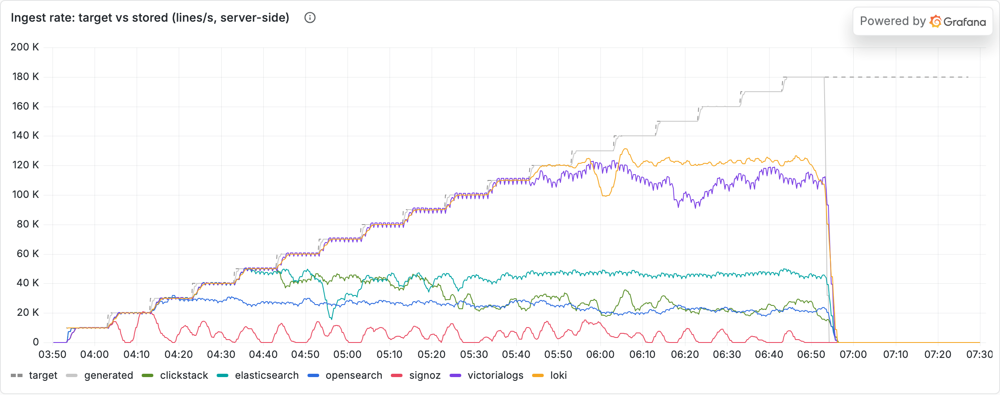

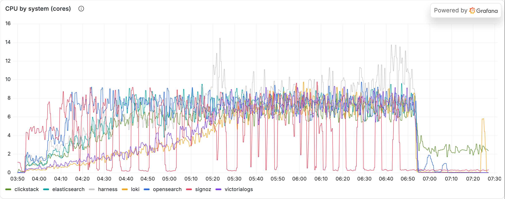

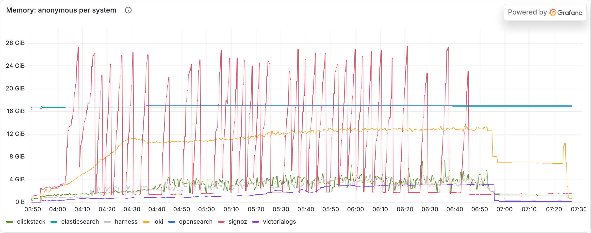

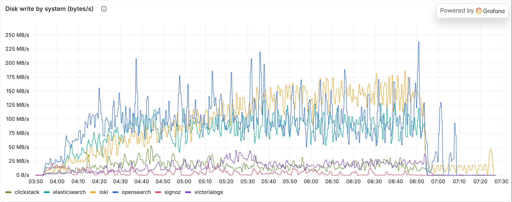

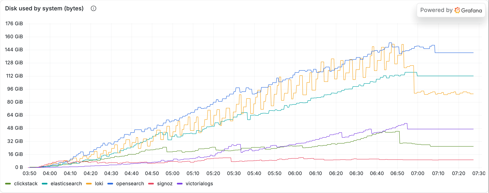

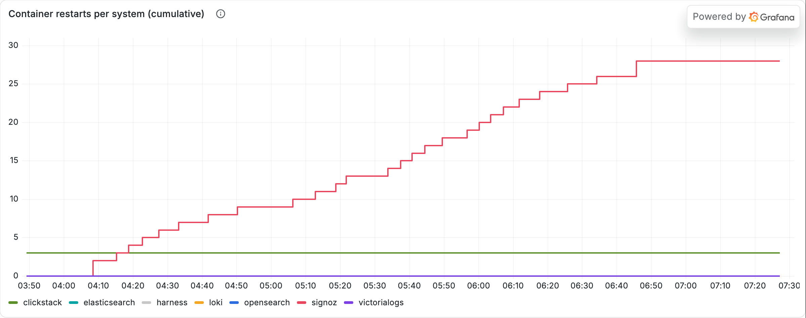

### Run 2

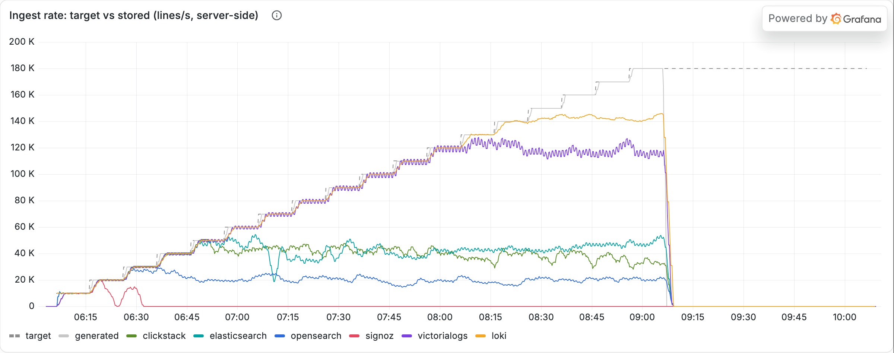

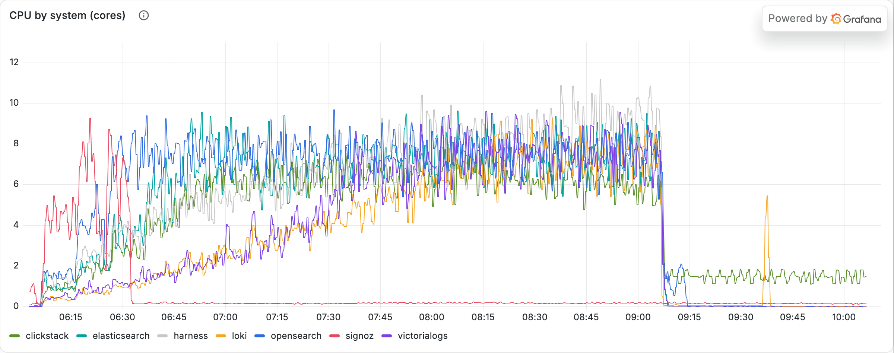

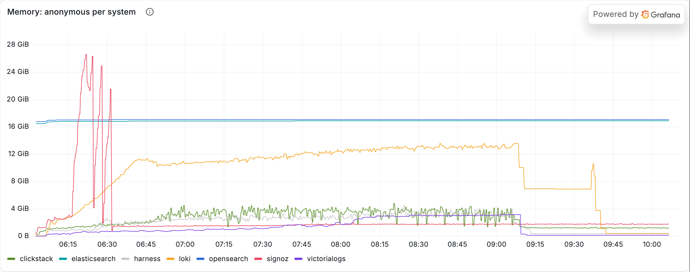

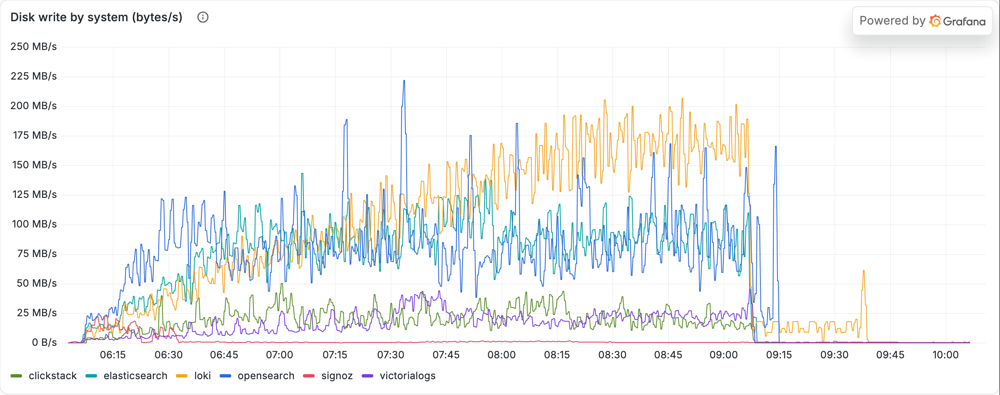

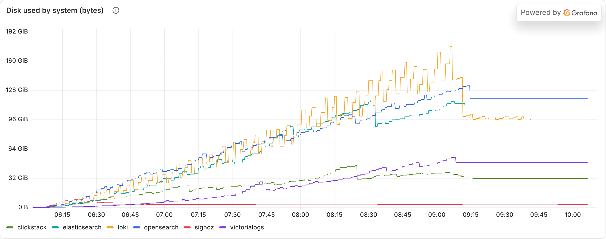

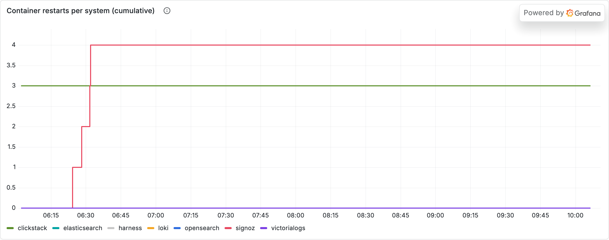

### Run 3

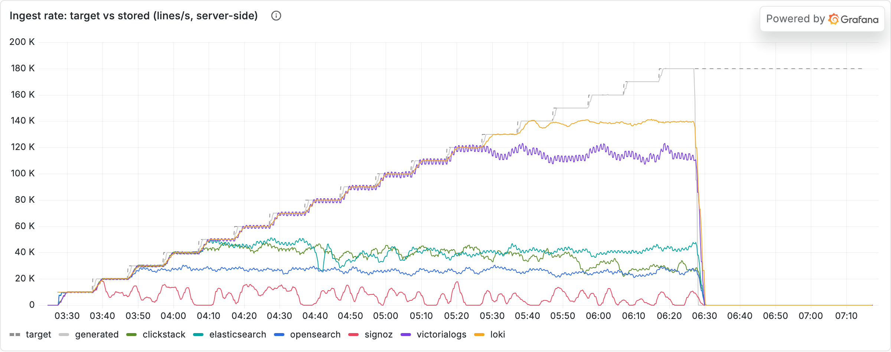

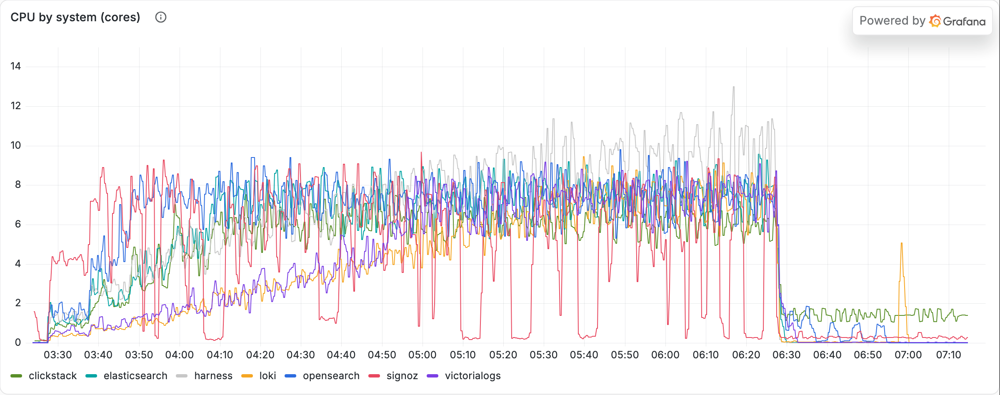

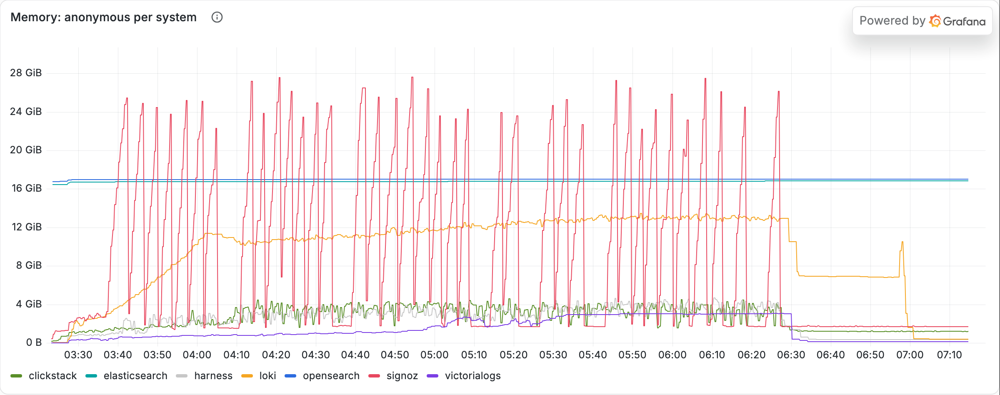

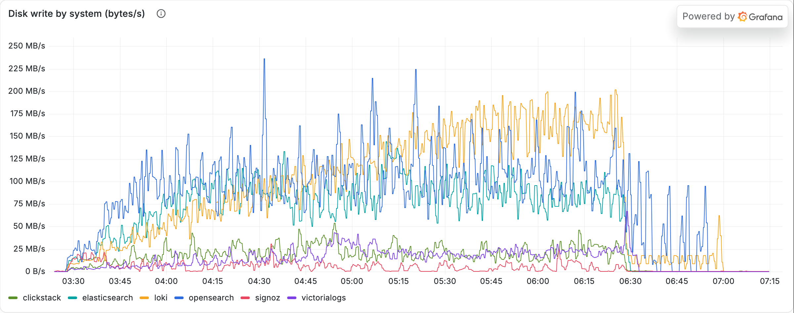

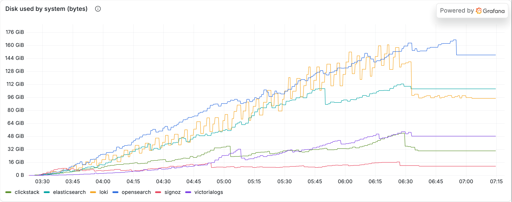

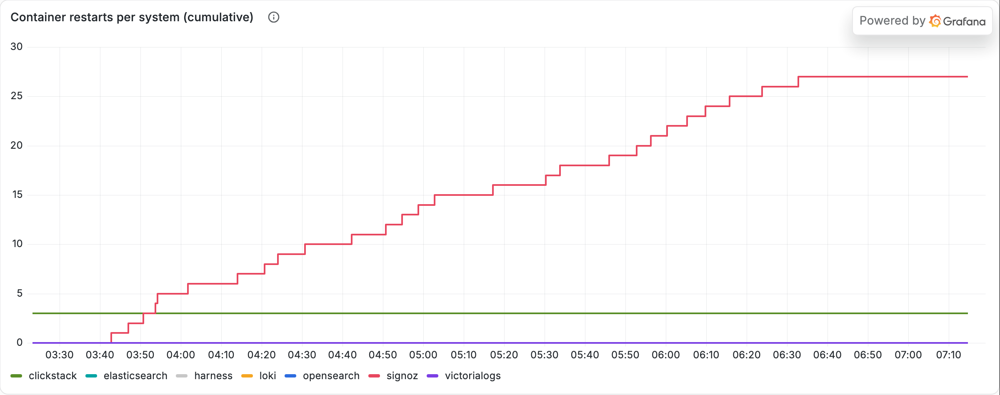
