# Ingestion test, Ravel on GCS and VictoriaLogs (November 2026)

Results of the ravel-gcs ingestion test, which follows the method of
benchmark 1 in the [roadmap](../../README.md#roadmap) with two engines. The
method is in the [README](../../README.md) and the
[runbook](../../deploy/benchmarks/ravel-gcs/README.md). The run config is
[ingest-ramp.yaml](../../deploy/benchmarks/ravel-gcs/ingest-ramp.yaml).

## Setup

Each engine runs on its own n2d-standard-8 node (8 vCPUs, 32 GB of RAM) on GKE
v1.36.4. VictoriaLogs stores on a 500 GiB pd-balanced disk on its node. Ravel
stores in a GCS bucket in the same region and uses no disk.

| Engine       | Version | Install                               |
| ------------ | ------- | ------------------------------------- |
| VictoriaLogs | v1.53.0 | victoria-logs-single 0.13.10          |
| Ravel        | 0.30.0  | ravel-render.sh, flags in the runbook |

Ravel runs at its shipped defaults with the flags listed in the runbook, and
its writer asks for buffered acks (`x-ravel-ingest-mode: buffered`): a 2xx
means the lines are buffered, not yet committed to GCS. Stored rows count only
committed rows.

Each run starts from empty instances: a new VictoriaLogs volume, an empty
Ravel bucket, and a newly deployed harness. No engine restarted in any run.

## How the numbers are computed

- Each number is the median of three runs.
- **Maximum ingestion rate**: the highest average stored rate over one
  10-minute step, among the steps before the engine's first crash. A step's
  average stored rate is the rows the engine stored during the step divided
  by the step's length. Averaging the dashboard's
  `deriv(logbench_stored_rows[3m])` over the step instead would lag each step
  change by about 1.5 minutes, and at the 10k step it reads both engines at
  87% of the target.
- **N/A**: in at least one run, the engine stored less than 90% of the
  step's target.
- **CPU** is the step average and **memory** the step peak without the page
  cache ("Memory: anonymous per system").
- **Disk writes per line**: for VictoriaLogs, the step average of the bytes
  written to its disk divided by the stored rate. Ravel has no disk, so two
  figures replace it, each the step average divided by the stored rate: **GCS
  bytes written per line** and **GCS write requests per line**. They come from
  ravel-server's own object-store counters, `ravel_store_bytes_total` and
  `ravel_store_calls_total` with `op="put"`, which the pod scrape
  (`deploy/monitoring/ravel-podscrape.yaml`) collects. The bytes are the
  bytes offered by the put calls, not wire bytes, and the calls are counted by
  ravel-server, not by GCS.
- **Disk space**: for VictoriaLogs, read after the ramp, once its disk has
  stayed the same for 10 minutes. For Ravel, the bucket's object bytes after
  the ramp, once they have stayed the same for 10 minutes
  (`gcloud storage du -s gs://<bucket>`). The compression ratio is the raw
  JSON size (887 MiB per million lines) divided by it.
- Each engine owns its node, so CPU, memory and disk count every pod on it.

The VictoriaLogs figures from this cluster match those of
[benchmark 1](../2026-10-ingest/README.md) within a few percent: 122k against
120k maximum ingestion, 7.2 cores and 2.6 GiB against 7.2 and 2.5 at the 120k
step, 167 against 163 disk bytes per line at 120k, and 56 MiB per million
lines on disk in both. That checks that this cluster reproduces the published
one.

Two monitoring fixes in this repository were needed for these figures, and
they apply to any GKE cluster:

- vmsingle's default `-maxLabelsPerTimeseries=40` dropped every per-pod
  cAdvisor series, because the kubelet scrapes copy about 30 node labels onto
  each one. The monitoring values now raise it to 64.
- The disk read and write panels summed each pod's I/O twice, once per
  container and once for the pod's own cgroup. They now keep only container
  series, as the CPU panel does.

## Results

### Maximum ingestion rate (lines/s)

| Engine       | Median | Range over 3 runs |
| ------------ | ------ | ----------------- |
| VictoriaLogs | 122k   | 122k to 125k      |
| Ravel        | 140k   | 139k to 150k      |

### CPU (cores)

| Engine       | 10k | 20k | 40k | 80k | 120k | 150k |
| ------------ | --- | --- | --- | --- | ---- | ---- |
| VictoriaLogs | 0.4 | 0.8 | 1.5 | 3.9 | 7.2  | N/A  |
| Ravel        | 0.3 | 0.7 | 1.5 | 3.2 | 5.3  | N/A  |

### Memory without the page cache (GiB)

| Engine       | 10k | 20k | 40k | 80k | 120k | 150k |
| ------------ | --- | --- | --- | --- | ---- | ---- |
| VictoriaLogs | 0.4 | 0.6 | 0.8 | 1.2 | 2.6  | N/A  |
| Ravel        | 0.5 | 0.6 | 0.9 | 1.3 | 1.6  | N/A  |

Ravel stored 150k at the 150k step in one run and 136k and 132k (91% and 88%)
in the other two, so that column is N/A for it.

### Disk space

| Engine       | MiB per million lines | Compression ratio |
| ------------ | --------------------- | ----------------- |
| VictoriaLogs | 56                    | 15.8x             |
| Ravel        | 71                    | 12.6x             |

Ravel's figure counts its objects as ingest wrote them. The benchmark runs
ravel-server as a single `--mode all` process, which ingests and answers
queries. Compaction runs in a separate `--mode maintain` process, which this
benchmark does not deploy, so none of Ravel's data here was compacted.

### Disk writes (bytes per stored line)

VictoriaLogs only. These numbers include the writes of indexes and background
merges.

| Engine       | 10k | 20k | 40k | 80k | 120k | 150k |
| ------------ | --- | --- | --- | --- | ---- | ---- |
| VictoriaLogs | 281 | 247 | 216 | 208 | 167  | N/A  |

### Ravel object-store writes per stored line

| Metric                                 | 10k   | 20k | 40k | 80k | 120k | 150k |
| -------------------------------------- | ----- | --- | --- | --- | ---- | ---- |
| GCS bytes written                      | 84    | 85  | 82  | 77  | 75   | N/A  |
| GCS write requests (per million lines) | 1,014 | 841 | 540 | 326 | 247  | N/A  |

## Charts

Drawn from the "Logs Benchmark" dashboard's own queries over each run's
window, times in UTC. The target line stays at 180k after the writer stops,
because the gauge is not reset.

### Run 1

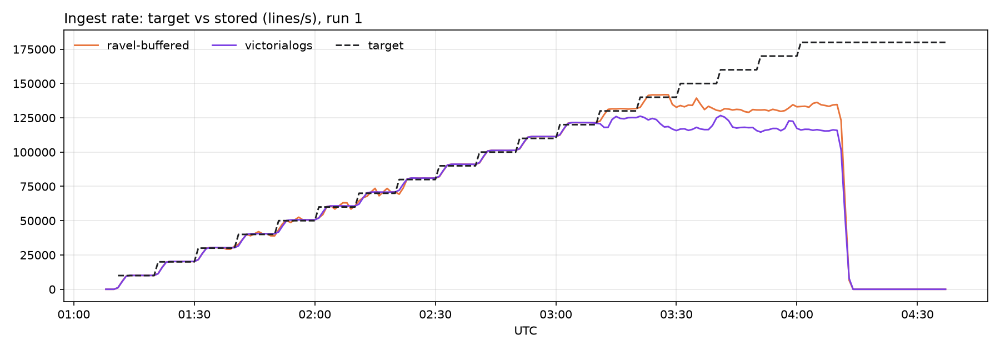

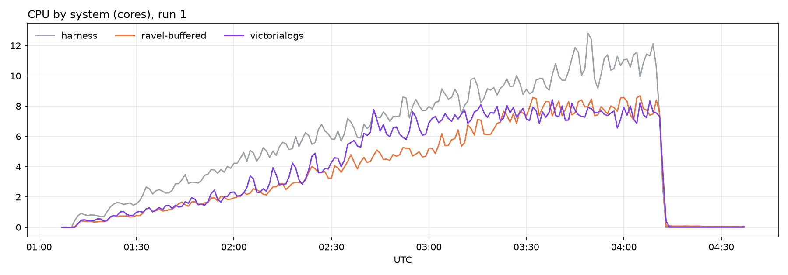

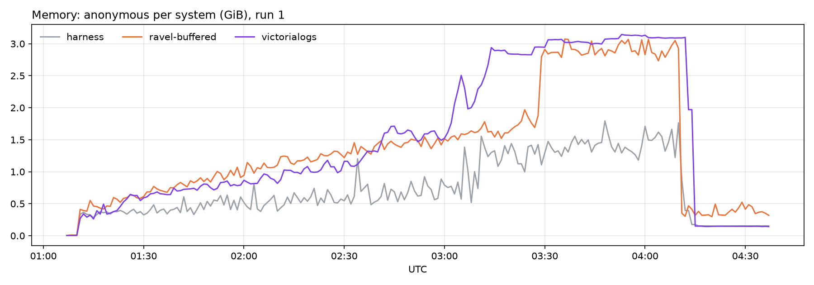

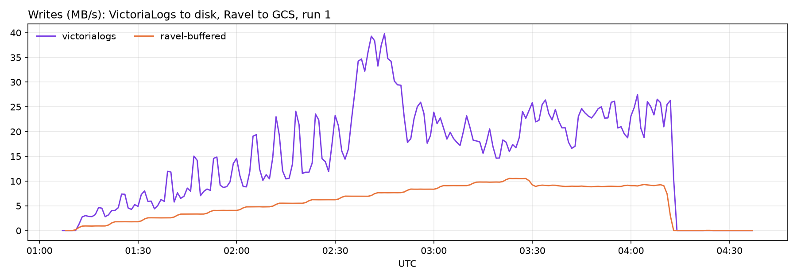

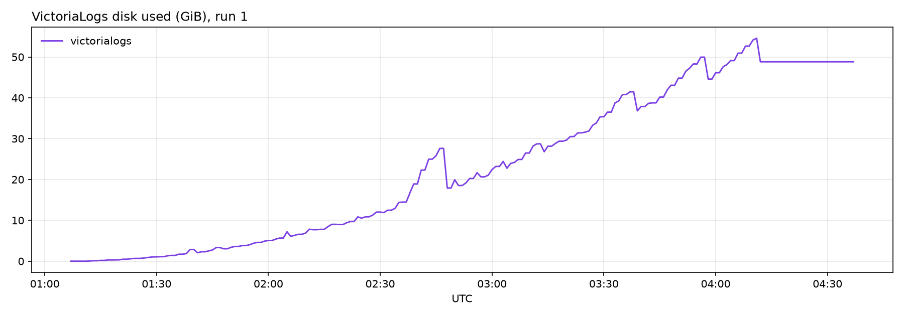

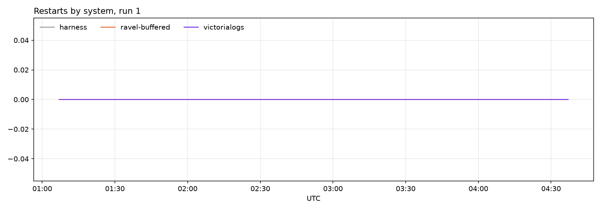

### Run 2

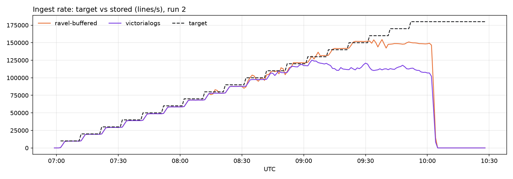

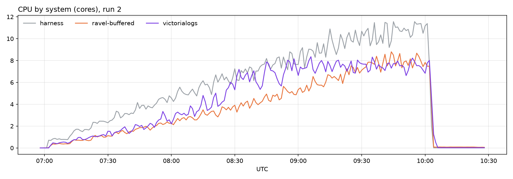

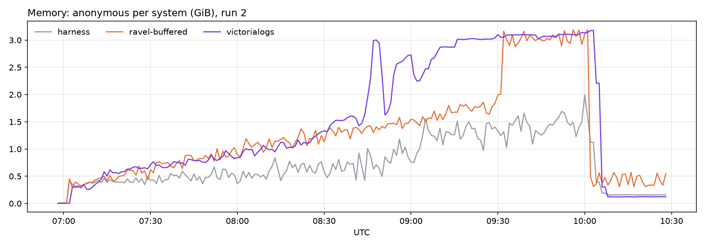

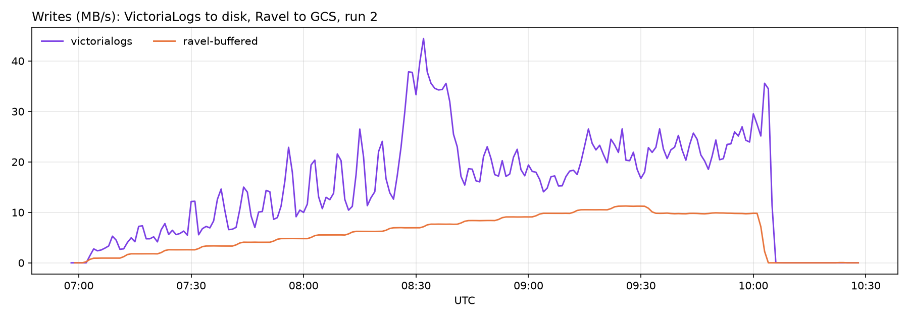

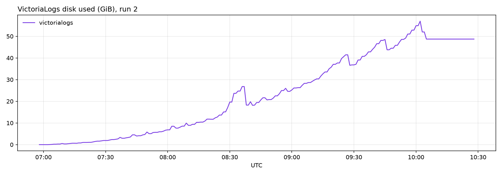

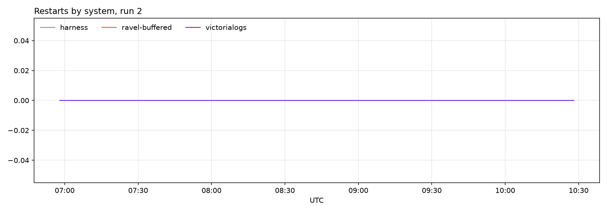

### Run 3

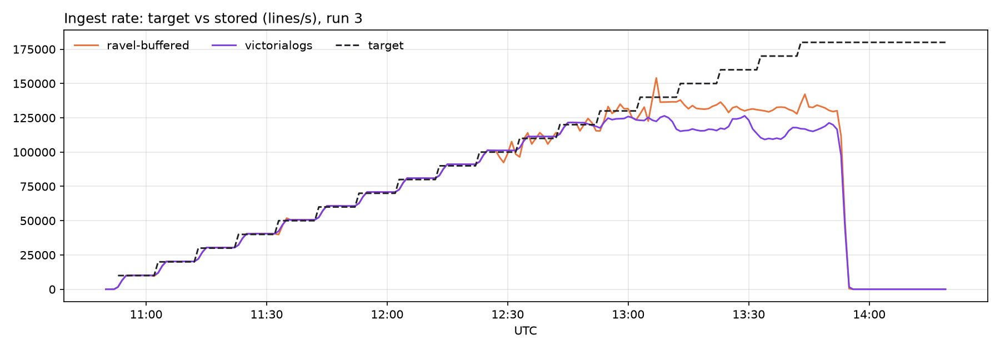

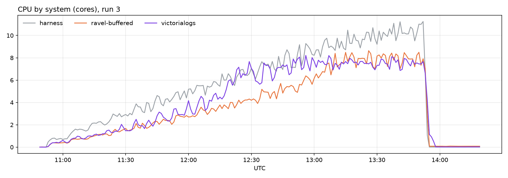

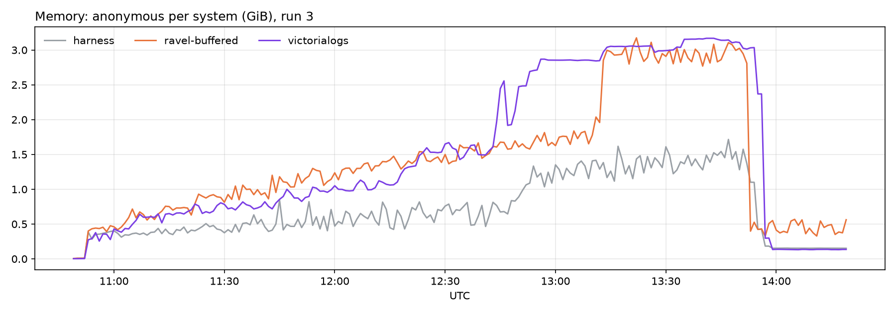

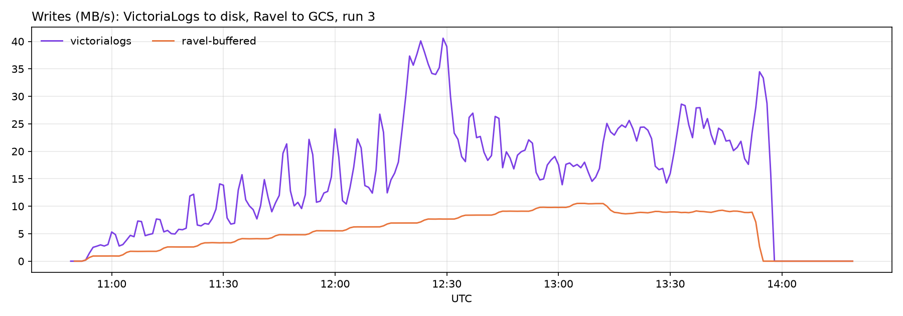

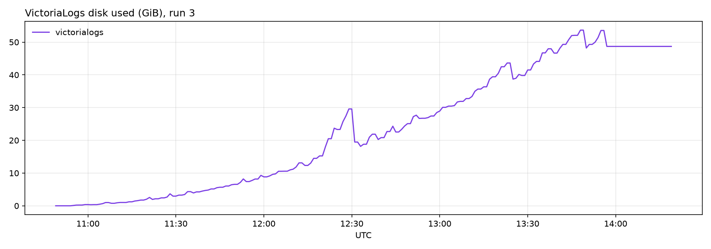

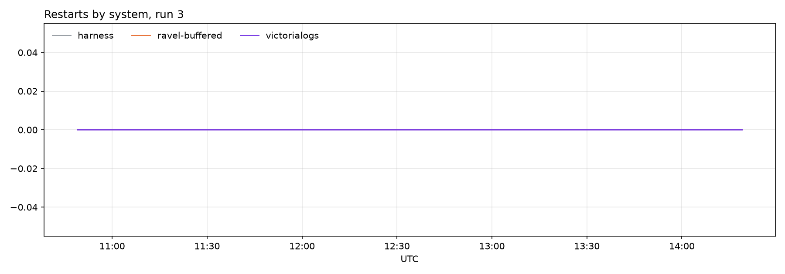
